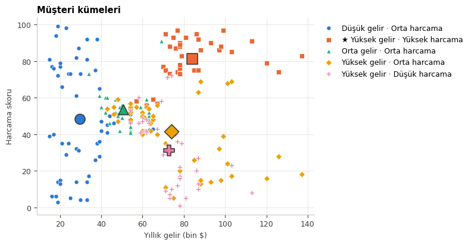

# Customer Segmentation with Self-Organizing Maps

[](https://colab.research.google.com/github/betulaltunyuva/som-customer-segmentation/blob/main/SOM_Musteri_Segmentasyonu.ipynb)


Customer segmentation on two real-world datasets using **Self-Organizing Maps (SOM)** combined with **K-Means** clustering.

| | Mall Customers | Credit Card Users |
|---|---|---|
| **Dataset** | [Mall Customers](https://www.kaggle.com/shwetabh123/mall-customers) | [Credit Card Dataset](https://www.kaggle.com/arjunbhasin2013/ccdata) |
| **Customers / features** | 200 / 3 | 8,950 / 17 |
| **Clusters** | 5 | 3 |
| **Goal** | Find the target customer group | Separate reliable customers from risky ones |

> 🇹🇷 The notebook itself is written in Turkish.

## Method

```
Data → Cleaning & 0-1 scaling → SOM training (20×20) → BMU position of each customer → K-Means → Interpretation
```

- **SOM:** 20×20 hexagonal grid, periodic boundary conditions (PBC), PCA weight initialization, online training, 10,000 epochs, learning rate 0.01
- **Clustering:** Each customer is placed at the map position of its best matching unit (BMU), and these positions are clustered with K-Means.
- **Labeling:** Clusters are named automatically from their mean values (e.g. *high income · high spending*, *risky*).

## Results

### 1. Mall customers

<p align="center">
  
</p>
<p align="center">
  
</p>

- **Target group:** the *high income · high spending* cluster (36 customers, 18%). Loyalty programs and premium products should focus on this group.
- Customers with high income but low or medium spending make up **41%** of all customers, the largest growth opportunity for the mall.
- Because age is also an input, older customers (mean age 56) formed a separate cluster.

### 2. Credit card users

<p align="center">
  
</p>
<p align="center">
  
</p>

| Segment | Share | Key behavior |
|---|---|---|
| 🟢 Reliable | 41% | Low balance, little cash advance, low debt |
| 🟡 Medium | 32% | Highest cash advance usage, yet the highest full-payment rate |
| 🔴 Risky | 27% | Highest balance and credit limit; almost never pays the full balance |

> The heaviest spenders ended up in the **risky** group because they keep carrying their balance over to the next month. High spending alone is not a sign of reliability.

## How to run

The easiest way is to open the notebook in Colab. The datasets are downloaded automatically with `kagglehub`.

To run locally:

```bash
pip install -r requirements.txt
jupyter notebook SOM_Musteri_Segmentasyonu.ipynb
```

## Files

```
├── SOM_Musteri_Segmentasyonu.ipynb   # Full analysis with outputs
├── requirements.txt
└── images/                           # Figures used in this README
```

---
<sub>Prepared as part of the course assignment *Development and Use of Artificial Neural Networks — Application 5: Clustering*.</sub>
