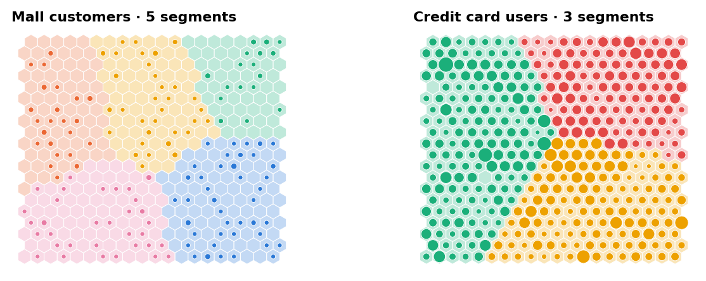
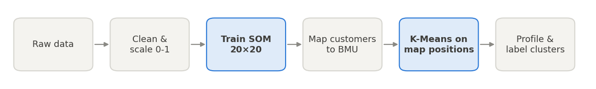
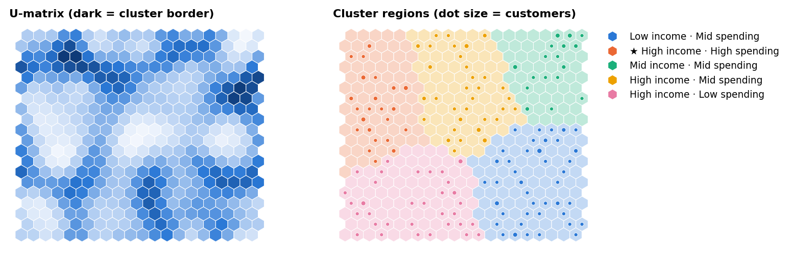
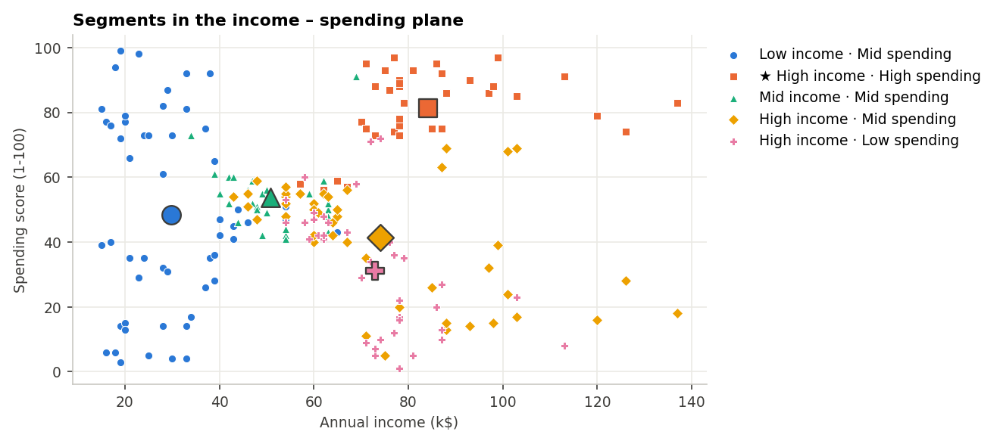
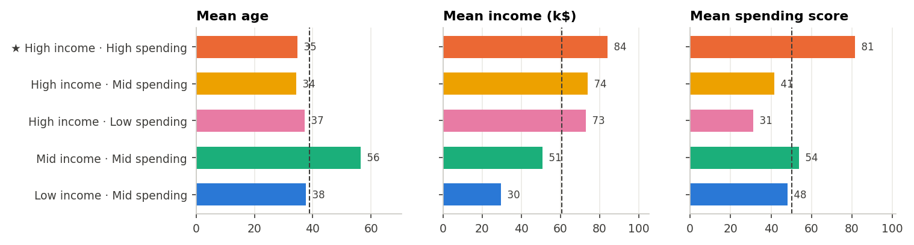
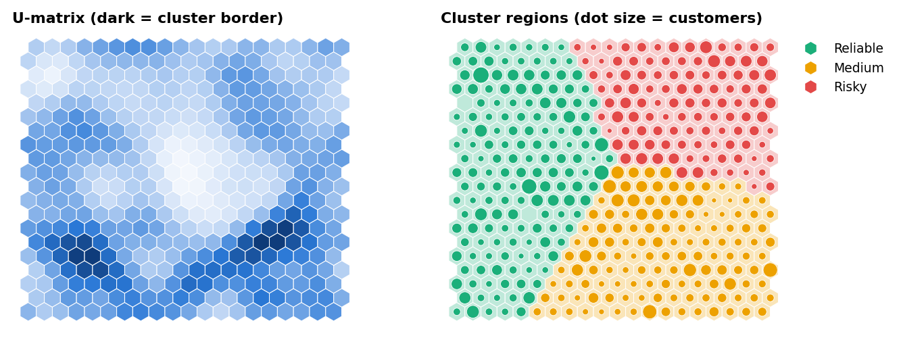
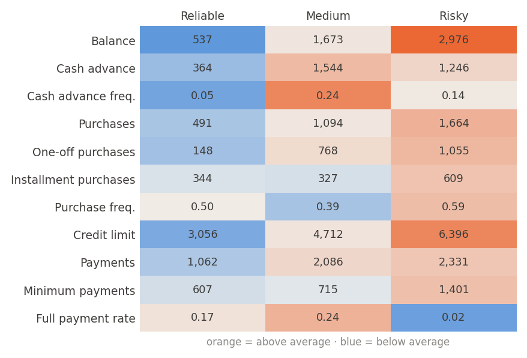
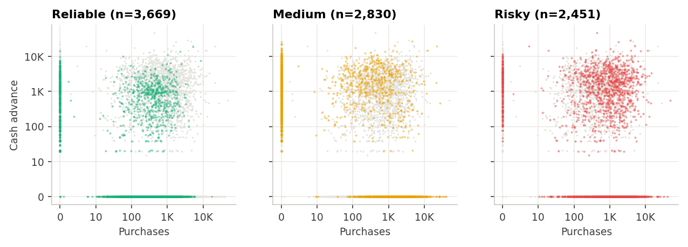
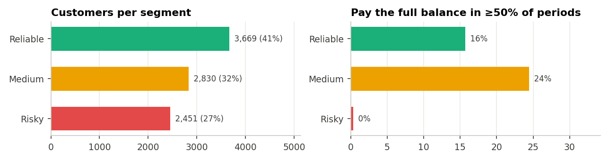

<div align="center">

# 🧠 Customer Segmentation with Self-Organizing Maps

**Unsupervised neural network clustering of mall shoppers and credit card users with SOM + K-Means**

[](https://colab.research.google.com/github/betulaltunyuva/som-customer-segmentation/blob/main/SOM_Musteri_Segmentasyonu.ipynb)




</div>

---

## 📌 Overview

Which customers should a store focus on? Which credit card holders are likely to become a risk? This project answers both questions with a **Self-Organizing Map (SOM)**. The SOM is an unsupervised neural network that projects high-dimensional customer data onto a 2D map while keeping similar customers next to each other. The regions of that map are then turned into customer segments with **K-Means**.

The same pipeline is applied to two real-world datasets of very different size:

| | 🛍️ Mall Customers | 💳 Credit Card Users |
|---|---|---|
| **Dataset** | [Mall Customers (Kaggle)](https://www.kaggle.com/shwetabh123/mall-customers) | [Credit Card Dataset for Clustering (Kaggle)](https://www.kaggle.com/arjunbhasin2013/ccdata) |
| **Size** | 200 customers × 3 features | 8,950 customers × 17 features |
| **Features** | Age, annual income, spending score | Balance, purchases, cash advance, credit limit, payments, full-payment rate… |
| **Clusters** | 5 | 3 |
| **Business question** | Who is the target customer? | Who is reliable and who is risky? |

> 🇹🇷 The notebook is written in Turkish; code, figures and results are easy to follow either way.

## 📑 Contents
- [How it works](#️-how-it-works)
- [Results: Mall customers](#️-results-mall-customers)
- [Results: Credit card users](#-results-credit-card-users)
- [Key insights](#-key-insights)
- [Getting started](#-getting-started)
- [Limitations & future work](#-limitations--future-work)
- [Developer](#-developer)

---

## ⚙️ How it works

<p align="center">
  
</p>

**Self-Organizing Map.** A SOM is a grid of neurons, and every neuron holds a weight vector with the same size as one customer record. During training a random customer is picked, the neuron closest to it (the **Best Matching Unit, BMU**) is found, and the BMU and its neighbors on the grid are pulled slightly toward that customer. The learning rate and the neighborhood radius shrink over time. In the end, **similar customers land on nearby neurons**, which gives a 2D "map" of the customer base.

**From map to segments.** Each customer is placed at the grid position of its BMU, and these positions are clustered with K-Means. Cluster IDs carry no meaning by themselves, so every cluster is **labeled automatically** from its average profile:
- *Mall:* income and spending levels (low / mid / high tertiles). The cluster with the highest income + spending is marked ★ as the target.
- *Credit card:* a simple risk score built from cluster-mean z-scores:

  `risk = z(balance) + z(cash advance) + z(cash advance freq.) − z(purchases) − z(full payment rate)`

| Hyperparameter | Value |
|---|---|
| Grid | 20 × 20 hexagonal (400 neurons) |
| Boundary | Periodic (PBC), so the map edges wrap around |
| Weight initialization | PCA |
| Training | Online, 10,000 epochs, learning rate 0.01 |
| Preprocessing | ID columns dropped, missing values → median, Min-Max scaling to 0-1 |
| Clustering | K-Means on BMU coordinates (k = 5 and k = 3) |
| Reproducibility | Fixed random seed (42) |

---

## 🛍️ Results: Mall customers

The **U-matrix** (left) shows the average distance between each neuron and its neighbors: light areas are groups of similar customers, dark bands are natural borders between groups. On the right, the map is split into five regions; dot size shows how many customers sit on each neuron.

<p align="center">
  
</p>

Projected back onto the original features, the segments separate the income – spending space (large markers are segment means):

<p align="center">
  
</p>

<p align="center">
  
  <br><sub>Dashed line = overall average</sub>
</p>

| Segment | Customers | Profile | Suggested action |
|---|---|---|---|
| ★ **High income · High spending** | 36 (18%) | Age 35 · income 84k$ · score 81 | **Target group.** Loyalty program, VIP perks, premium products |
| **High income · Low spending** | 38 (19%) | Age 37 · income 73k$ · score 31 | Biggest untapped potential: personalized campaigns |
| **High income · Mid spending** | 45 (22%) | Age 34 · income 74k$ · score 42 | Young and affluent: cross-selling, upselling |
| **Mid income · Mid spending** | 27 (14%) | Age 56 · income 51k$ · score 54 | Oldest group: quality- and service-focused messaging |
| **Low income · Mid spending** | 54 (27%) | Age 38 · income 30k$ · score 48 | Largest group: discounts, affordable lines, installments |

---

## 💳 Results: Credit card users

<p align="center">
  
</p>

<table>
<tr>
<td width="50%" valign="top">

**Segment profiles.** Each cell shows the segment mean; color shows how far it is from the overall average.



</td>
<td width="50%" valign="top">

| Segment | Share | Behavior |
|---|---|---|
| 🟢 **Reliable** | 41% | Lowest balance and cash advance; small, frequent and often installment purchases; low debt |
| 🟡 **Medium** | 32% | Heaviest **cash advance** users and fewest purchases, yet the highest full-payment rate |
| 🔴 **Risky** | 27% | Highest balance, credit limit and minimum payments; **almost never pays the full balance** |

</td>
</tr>
</table>

Purchases vs. cash advance (log scale; each panel highlights one segment):

<p align="center">
  
</p>
<p align="center">
  
</p>

---

## 💡 Key insights

- 🎯 **The mall's target group** is the *high income · high spending* segment, about one in five customers.
- 📈 **41% of mall customers have high income but low or medium spending.** This is the biggest growth opportunity.
- 👥 Because age is an input, the SOM separated an **older customer group** (mean age 56) but merged low-income shoppers into a single segment.
- 💳 **High spending ≠ reliability.** The heaviest card spenders ended up in the *risky* segment because they keep carrying their balance to the next month (full-payment rate ≈ 0.02).
- 💵 **Cash advance usage** is the defining trait of the *medium* group and an early warning sign of financial stress.

---

## 🚀 Getting started

**Option 1: Colab (recommended).** Click the *Open in Colab* badge above and run all cells. Both datasets are downloaded automatically with `kagglehub`; if the download fails, you are asked to upload the CSV.

**Option 2: Locally.**

```bash
git clone https://github.com/betulaltunyuva/som-customer-segmentation.git
cd som-customer-segmentation
pip install -r requirements.txt
jupyter notebook SOM_Musteri_Segmentasyonu.ipynb
```

> Training both SOMs takes about 3 minutes on a regular laptop.

### Project structure

```
som-customer-segmentation/
├── SOM_Musteri_Segmentasyonu.ipynb   # Full analysis with outputs (Turkish)
├── requirements.txt                  # Dependencies
├── images/                           # Figures used in this README
└── README.md
```

---

## 🔭 Limitations & future work

- K-Means runs on the 2D map coordinates, so it does not account for the wrap-around of the periodic boundaries.
- The credit card data is highly skewed; Min-Max scaling is sensitive to outliers. A log transform or `RobustScaler` could give more balanced segments.
- The number of clusters comes from the problem definition. The elbow method or silhouette score could choose it from the data instead.
- Clustering the neuron weight vectors directly (instead of BMU coordinates) is another option worth comparing.

---

## 👩‍💻 Developer

<table>
<tr>
<td>

**Betül Altunyuva**
GitHub: [@betulaltunyuva](https://github.com/betulaltunyuva)

</td>
</tr>
</table>

<sub>Developed as part of the course assignment *Development and Use of Artificial Neural Networks: Application 5, Clustering*.</sub>

<div align="center">

⭐ If you found this project useful, consider giving it a star!

</div>
